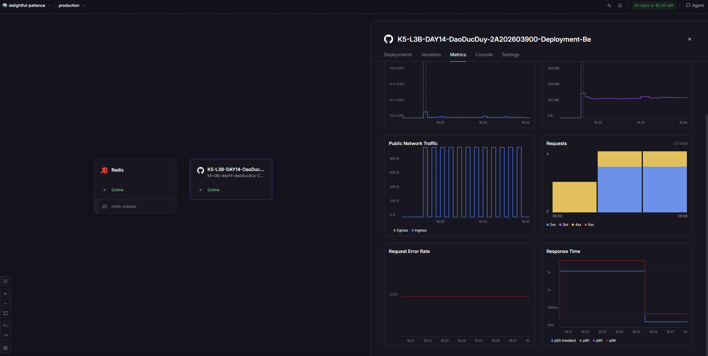
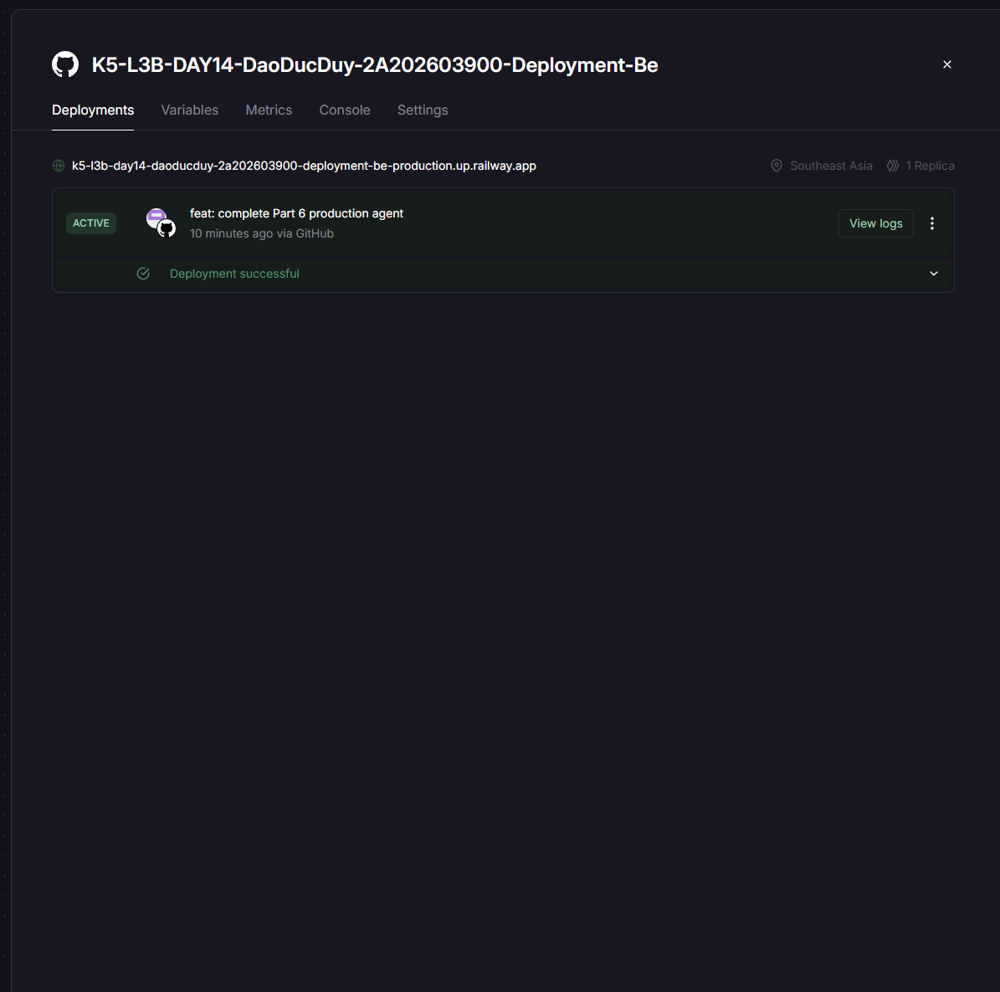
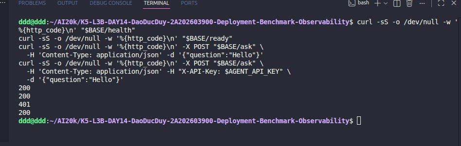

# Deployment Information

## Public Service

- Platform: Railway
- Public URL: https://k5-l3b-day14-daoducduy-2a202603900-deployment-be-production.up.railway.app
- Railway service root directory: `06-lab-complete`

## Environment Variables

Configured on Railway (values intentionally not recorded here):

- `AGENT_API_KEY`
- `REDIS_URL`
- `RATE_LIMIT_PER_MINUTE`
- `DAILY_BUDGET_USD`
- `ENVIRONMENT`
- `PORT` (provided by Railway)

## Public Endpoint Checks

The four CP6 checks were run against the deployed Railway service:

| Check | Expected | Result |
|---|---:|---:|
| `GET /health` | 200 | 200 |
| `GET /ready` | 200 | 200 |
| `POST /ask` without `X-API-Key` | 401 | 401 |
| `POST /ask` with configured `X-API-Key` | 200 | 200 |

Re-run without exposing the API key in the command history:

```bash
BASE='https://k5-l3b-day14-daoducduy-2a202603900-deployment-be-production.up.railway.app'
read -rsp 'AGENT_API_KEY: ' AGENT_API_KEY
echo

curl -sS -o /dev/null -w '%{http_code}\n' "$BASE/health"
curl -sS -o /dev/null -w '%{http_code}\n' "$BASE/ready"
curl -sS -o /dev/null -w '%{http_code}\n' -X POST "$BASE/ask" \
  -H 'Content-Type: application/json' -d '{"question":"Hello"}'
curl -sS -o /dev/null -w '%{http_code}\n' -X POST "$BASE/ask" \
  -H 'Content-Type: application/json' -H "X-API-Key: $AGENT_API_KEY" \
  -d '{"question":"Hello"}'
```

## Screenshots

The screenshots below document the Railway service/metrics, active deployment and public endpoint checks. No API key is visible in them.

- `screenshots/railway-dashboard.png`
- `screenshots/railway-running.png`
- `screenshots/railway-test.png`
- Submission-name copies: `screenshots/dashboard.png`, `screenshots/running.png`, `screenshots/test.png`






